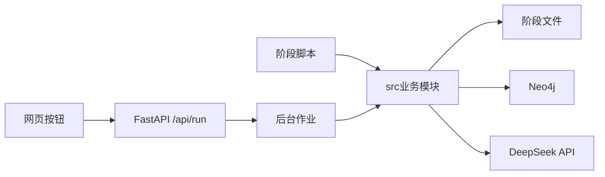

# 中文代码阅读指南

## 建议阅读顺序

1. `src/common/models.py`：理解实体、关系与三元组类型约束。
2. `src/papers/pipeline.py`：理解PDF元数据、文件哈希、页码和文本块。
3. `src/extraction/pipeline.py` → `client.py`：先看提示和结构化抽取，再看HTTP、缓存与重试。
4. `src/review/service.py`：理解候选与正式事实的区别、别名归一和证据检查。
5. `src/graph/store.py`：看Cypher约束、事务导入、查询和快照。
6. `src/classification/features.py` → `task.py`：看图结构如何转成特征、留一交叉验证。
7. `src/prediction/task.py`：看遮蔽、路径分数、过滤排名与平均秩。
8. `src/generation/task.py`：看实体匹配、两跳检索和引用核对。
9. `scripts/` → `backend/app.py` → `frontend/app.js`：观察同一算法如何被终端和按钮调用。

## 核心调用关系

每个阶段都把输入输出保存在文件中，便于打开JSON验证。不要一开始就阅读HTTP和后台任务，先理解单个三元组和算法。

## 学习练习

- 增加一种关系前，先说明主体/客体类型、证据规则，再修改本体和查询。
- 修改教学样例的组件连接，比较一跳与二跳分类特征。
- 隐藏某个组件的全部边，观察覆盖率下降以及条件MRR与端到端MRR的区别。
- 给生成结果放入不存在的事实ID，观察引用校验如何拒绝。

## 命名与边界

- `Candidate`：结构合法的候选，不代表已证实。
- `Evidence`：支撑事实的原文片段及出处。
- `snapshot`：某次图谱导入后的固定数据版本，用于复现实验。
- `graph_version`：内容哈希，检测评测是否使用过期数据。
- `verified`：人工确认标签集合完整，不是程序根据缺边猜测负例。
